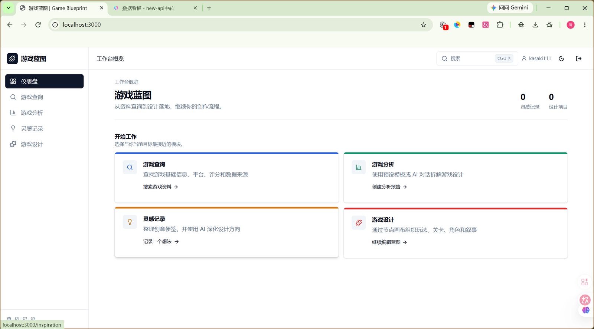
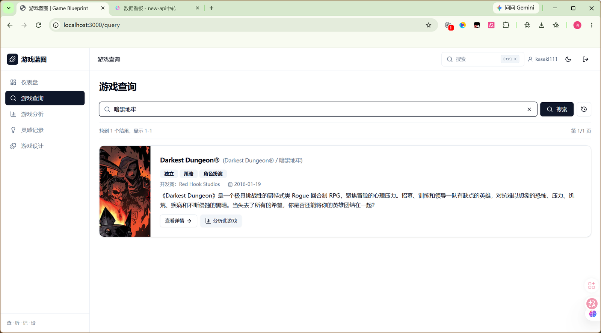
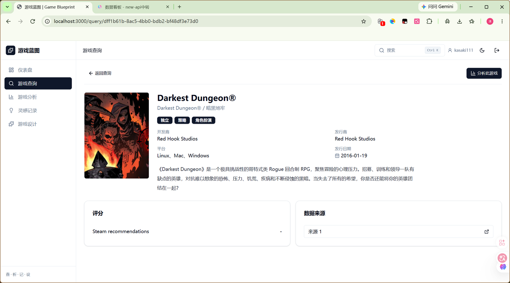
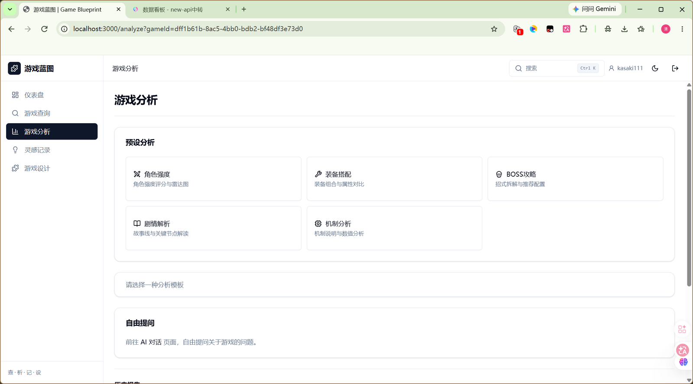
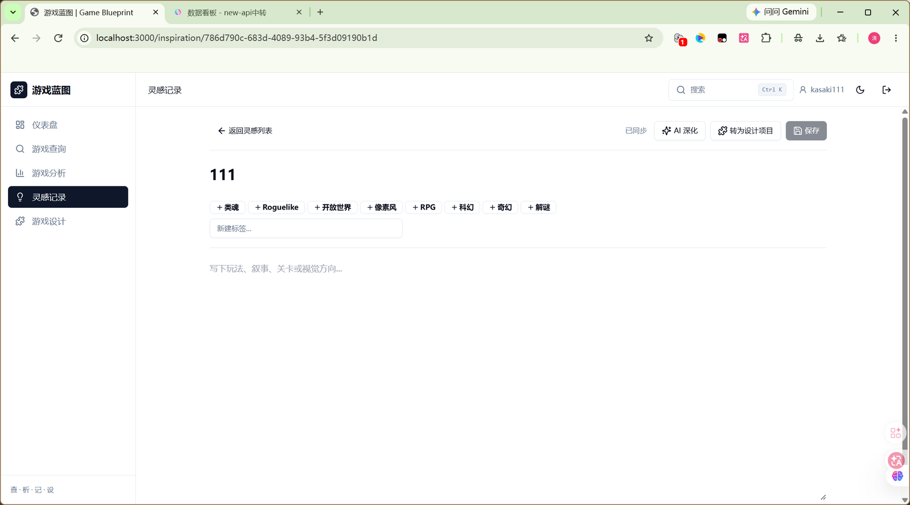
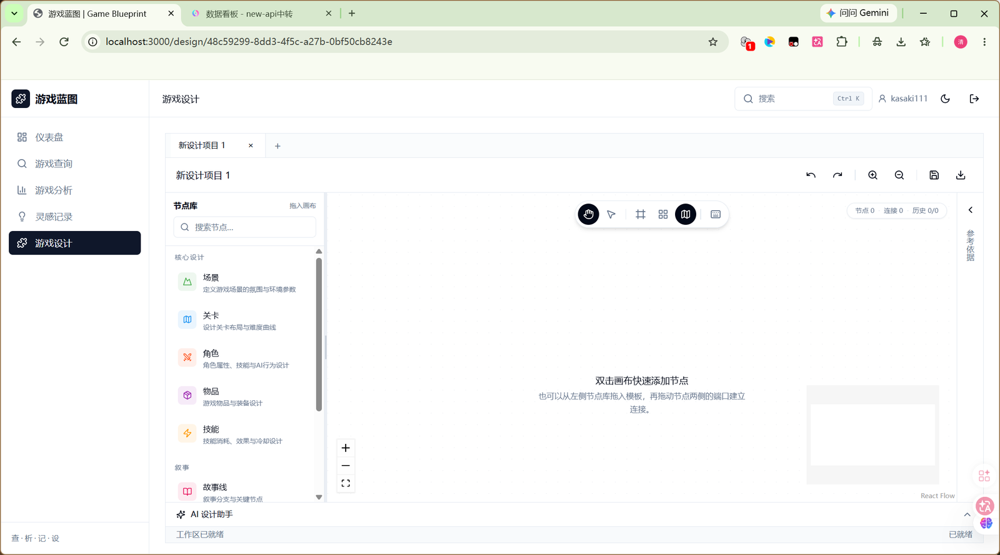
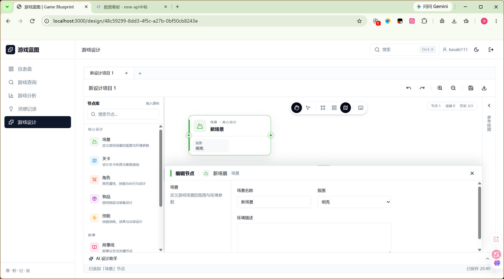

# 游戏蓝图 (Game Blueprint)

游戏蓝图是一个面向游戏玩家、创作者与数据分析者的综合平台，提供从「查」到「析」到「记」再到「设」的完整工作流。

仪表盘（`/`）是默认入口。仪表盘中的四个功能模块会在浏览器新标签页打开对应页面；进入设计工作台后，节点模板、画布和依据位于上方，选中节点时节点编辑面板以浮层显示在画布底部，可拖动分隔条调整高度。

## 当前能力

| 模块 | 页面 | 当前能力 |
|------|------|----------|
| 游戏查询 | `/query` | 中文名、原名、别名及游戏元数据模糊检索，详情展示、搜索历史、最近结果恢复 |
| 游戏分析 | `/analyze` | pgvector + PostgreSQL 全文混合检索、检索调试、预设分析、流式 AI 对话、报告查看与导出 |
| 灵感记录 | `/inspiration` | 灵感 CRUD、标签、AI 深化、灵感转设计项目 |
| 游戏设计 | `/design` | 项目 CRUD、节点卡片画布、多标签工作区、本地恢复、内容指纹防抖与串行保存、版本冲突节点级合并、多标签更新提示、撤销/重做、复制/剪切/粘贴、JSON 导出 |
| 跨模块能力 | - | 全局搜索、RAG 上下文检索、通用 JSON 导出 |

设计画布的节点卡片展示类型图标、分类和关键字段摘要；连接时可以从节点两侧端口拖到目标节点的任意位置，选中连线后可删除。画布提供平移/框选模式、双击快速添加、自动整理布局、缩略图开关和快捷键面板。选中节点后属性面板以浮层覆盖在画布底部，不会压缩画布尺寸。

设计工作台只会在节点/连线等内容真正变化时保存，选中节点和切换标签页不会增加服务端 `revision`。保存失败时本地副本仍保留，可在状态栏点击重试；两个标签页同时编辑时，后保存的一方会收到版本冲突提示，并可选择按节点合并、使用服务器版本或另存为新项目。工作区文档带 `schemaVersion`（当前为 2），旧版 `{ nodes, edges }` 数据会在读取时自动迁移。

未配置 LLM API Key 时，AI 分析会使用离线降级响应，查询、灵感和设计等核心流程仍可运行。

## 功能预览

以下截图来自本地运行实例，按「查 → 析 → 记 → 设」的顺序展示主要界面。

### 仪表盘

工作台概览会汇总灵感记录和设计项目数量，四个模块卡片分别进入对应页面。



### 游戏查询

搜索结果支持中文名、原名、别名和元数据模糊匹配；详情页展示开发商、发行商、平台、发行日期、评分与数据来源，并可一键进入分析。

<p align="center">
  
  
</p>

### 游戏分析

分析页提供角色强度、装备搭配、BOSS 攻略、剧情解析和机制分析五种预设模板，也支持自由提问和检索调试。



### 灵感记录

灵感编辑器支持标签、正文、AI 深化和转设计项目，保存状态会显示在页面右上角。



### 游戏设计

画布支持拖入节点模板或双击快速添加；选中节点后，编辑面板以浮层覆盖在画布底部，可拖动调整高度或关闭。

<p align="center">
  
  
</p>

更多画布细节：[节点卡片与连线](docs/canvas-redesign.png)、[快速添加](docs/canvas-quick-add.png)、[节点编辑浮层](docs/canvas-inspector.png)。

## 项目架构

```text
Game Blueprint/
|-- frontend/           # Next.js 15 + React 19 + Tailwind CSS
|   |-- src/app/        # 页面与 Route Handlers
|   |-- src/components/ # 业务组件与 UI 组件
|   `-- src/lib/        # API 客户端、类型、工作区迁移与保存队列
|-- backend/            # FastAPI 模块化单体
|   |-- app/core/       # 配置、数据库与依赖
|   |-- app/engine/     # LLM、RAG 检索与文本处理
|   |-- app/models/     # SQLAlchemy 数据模型
|   |-- app/modules/    # query/analyze/inspiration/design/system
|   `-- app/workers/    # HTTP 爬虫与 ARQ 调度器
|-- docker-compose.yml  # PostgreSQL/pgvector、MongoDB、Redis、前后端
`-- 功能更新与问题修复.md
```

前端通过 Next.js Route Handlers 代理 `/api/*` 请求到 FastAPI。结构化业务数据存储在 PostgreSQL，原始抓取结果同步到 MongoDB，Redis 承担任务队列，`document_chunks` 使用 PostgreSQL 全文索引与 pgvector 完成 RRF 混合召回。中文全文检索在写入和查询前会按 CJK 二元组切分（`app/engine/text_search.py`），避免 `simple` 配置把整句中文当成一个词；未配置 `OPENAI_API_KEY` 时不会生成新向量，但关键词检索和其他核心流程仍可运行。

## 快速开始

### Docker 一键部署（推荐）

```bash
# 可选：复制环境变量并填写 OPENAI_API_KEY 或 ANTHROPIC_API_KEY
cp .env.example .env

docker compose up --build -d
docker compose ps
```

部署完成后访问：

- Web：<http://localhost:3000>
- API 文档：<http://localhost:8000/docs>
- 健康检查：<http://localhost:8000/health>（返回 PostgreSQL、pgvector 索引、Redis、爬虫 Worker 和 MongoDB 状态）

PostgreSQL 容器内部仍使用 `5432`，主机映射为 `15432`，用于避开 Windows 常见的 `5432` 端口占用或系统保留。后端容器通过 Compose 内网连接 `postgres:5432`，无需修改数据库连接串。

游戏查询在本地缓存未命中时会自动提交 Steam + 中文 Wikipedia 抓取任务。
Wikipedia 先通过 MediaWiki 搜索定位标题，再调用 REST Summary 获取结构化摘要；REST 不可用时回退 Action API，Wikipedia 整体失败时仍可使用 Steam 数据完成部分入库。
`crawler-worker` 独立处理任务，前端显示进度并在入库后自动刷新结果。抓取时会保存搜索词、Steam 中文标题、英文标题及 Wikipedia 标题作为别名，并自动更新全文与向量索引。
最近一次查询条件和结果会保存在当前浏览器会话中，返回查询页时自动恢复。

抓取任务接口：

- `POST /api/query/crawl`，请求体 `{ "q": "游戏名称" }`
- `GET /api/query/crawl/{job_id}`，查询排队、来源请求、合并和入库进度
- `POST /api/rag/retrieve`，请求体 `{ "query": "问题", "top_k": 5 }`，返回召回文档、来源及融合分数；分析页底部的“检索调试”提供同等可视化入口

已有目录需要补建索引时，在后端环境执行：

```bash
# 重建指定游戏的元数据分块（会按需调用 embedding；无 Key 时只更新全文索引）
python -m scripts.reindex_games

# 仅用现有分块重建中文全文索引，不调用 embedding，适合升级后执行
python -m scripts.reindex_search
```

升级到 CJK 分词版本后，必须对已有数据执行一次 `python -m scripts.reindex_search`，否则旧分块的 `search_vector` 仍按旧规则生成。

数据库表由 Alembic 管理：Docker 镜像启动时会先执行 `alembic upgrade head`；本地直接运行后端前也需要先执行同一命令。当前不会自动写入演示用户或游戏目录数据。

```bash
docker compose logs -f backend frontend
docker compose down
```

如需同时清空本地数据库卷，可运行 `docker compose down -v`。该操作会删除本地 PostgreSQL 和 MongoDB 数据。

### Docker 热更新开发

开发时无需每次修改代码都重建或重启服务，使用开发覆盖配置启动：

```bash
docker compose -f docker-compose.yml -f docker-compose.dev.yml up --build -d
```

该配置将 `backend` 和 `frontend` 源码挂载到容器，并分别启用 Uvicorn `--reload` 和 Next.js `dev` 热更新。修改 Python、TypeScript、React 或样式文件后会自动生效；只有依赖文件（如 `requirements.txt`、`package.json`）或 Dockerfile 变化时才需要重新执行上述命令。生产部署仍使用默认的 `docker-compose.yml`。

如果前端镜像构建时出现 Corepack 访问 `registry.npmjs.org` 超时，可使用项目默认的 npm 镜像源重新构建：

```powershell
docker compose -f docker-compose.yml -f docker-compose.dev.yml build --no-cache frontend
docker compose -f docker-compose.yml -f docker-compose.dev.yml up -d
```

Dockerfile 默认使用 `https://registry.npmmirror.com`，也可以在构建时覆盖：

```powershell
docker compose -f docker-compose.yml -f docker-compose.dev.yml build --build-arg NPM_REGISTRY=https://registry.npmjs.org frontend
```

### 本地开发

前置条件：Node.js 22+、Python 3.11+，以及可用的 PostgreSQL、MongoDB 和 Redis。Docker 前端构建镜像使用 `node:22-alpine`。

1. 启动基础设施（在项目根目录执行；PostgreSQL 宿主机端口为 `15432`）：

   ```powershell
   docker compose up -d postgres mongodb redis
   docker compose ps
   ```

   等待 `postgres`、`mongodb`、`redis` 状态变为 `healthy`。本机运行的后端连接 PostgreSQL 时使用 `localhost:15432`；容器内服务之间才使用 `postgres:5432`。如果不使用 Docker，请自行启动 PostgreSQL，并确保连接配置中的端口与实际监听端口一致。

2. 配置并启动后端：

   ```powershell
   if (-not (Test-Path backend/.env)) { Copy-Item .env.example backend/.env }
   # 检查实际数据库地址；Docker Compose 映射为宿主机 15432
   Select-String -Path backend/.env -Pattern '^\s*POSTGRES_DSN'
   Set-Location backend
   python -m venv venv
   .\venv\Scripts\Activate.ps1
   pip install -r requirements.txt
   python -m uvicorn app.main:app --reload --port 8000
   ```

   如果 `backend/.env` 已存在，请检查其中 `POSTGRES_DSN`，保证地址/端口与正在运行的 PostgreSQL 相符。不要在本机后端配置里使用容器专用主机名 `postgres`。

3. 启动前端：

   ```powershell
   Set-Location frontend
   # 如果 pnpm 已安装，使用：
   pnpm install
   pnpm dev
   ```

   如果 PowerShell 提示找不到 `pnpm`，说明 pnpm 未安装或未加入 PATH。可直接使用 npm（Node.js 自带）：

   ```powershell
   Set-Location frontend
   npm install
   npm run dev
   ```

   如果 `npm` 和 `node` 也无法识别，请先安装 Node.js 22+，重新打开 PowerShell 后再执行上述命令。也可以在已安装 Node.js 的情况下启用 Corepack，再安装 pnpm：

   ```powershell
   corepack enable
   corepack prepare pnpm@latest --activate
   pnpm install
   pnpm dev
   ```

前端默认访问 <http://localhost:3000>，后端 API 文档访问 <http://localhost:8000/docs>，健康检查访问 <http://localhost:8000/health>。不要将 `http://localhost:8000` 当作前端首页；它是 FastAPI 后端地址，根路径不提供 Next.js 页面。前端通过 `BACKEND_API_URL` 连接后端；本地未设置时默认使用 `http://localhost:8000/api`。`NEXT_PUBLIC_API_URL` 或 `NEXT_PUBLIC_BACKEND_URL` 即使填写为不带 `/api` 的主机地址，前端也会自动补齐 API 前缀。

## 技术栈

- 前端：Next.js 15、React 19、TypeScript、Tailwind CSS、Radix UI、React Flow 11、D3.js
- 后端：Python 3.11、FastAPI、SQLAlchemy Async、Pydantic Settings
- AI：OpenAI 兼容接口（未配置 Key 时离线降级）、pgvector + 全文 RRF 混合检索
- 数据：PostgreSQL 17 + pgvector、MongoDB 7、Redis 7
- 数据采集：httpx、Wikipedia REST/Action API、Playwright、ARQ 周期任务

## 常用验证

```powershell
# 前端类型检查
Set-Location frontend
pnpm lint

# 前端纯逻辑单元测试（内容指纹、工作区迁移、合并、保存队列）
pnpm test:unit

# 前端生产构建
pnpm build

# 后端测试
Set-Location ..\backend
pytest
```

## 文档

- `游戏蓝图_设计框架.md`：当前架构、模块、数据模型与接口设计
- `功能更新与问题修复.md`：按日期倒序记录功能更新、问题修复、配置变化、验证结果和已知限制
- `AGENTS.md`：规定完整功能修改结束后的文档同步检查与提示规则
